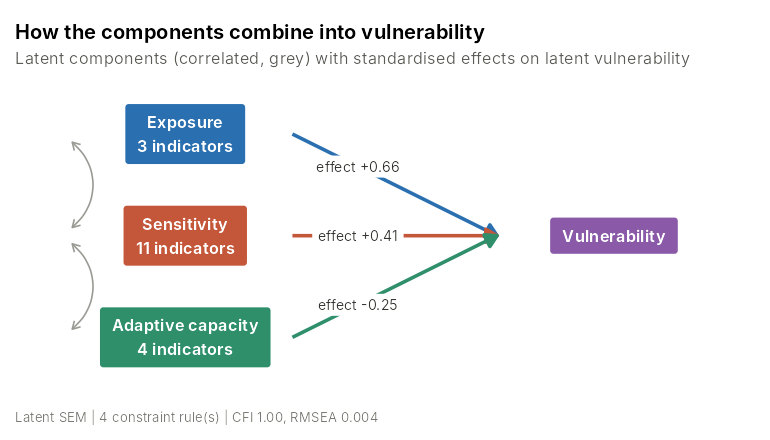
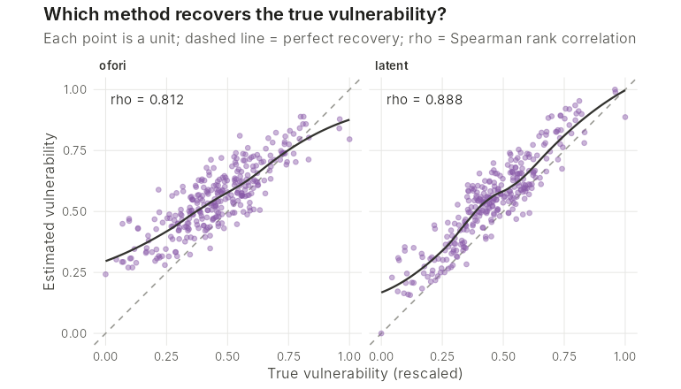
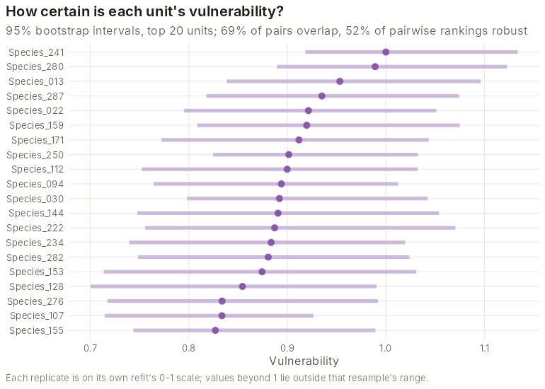

# ccva

<!-- badges: start -->
[](https://github.com/DoostiH/ccva/actions/workflows/R-CMD-check.yaml)
<!-- badges: end -->

**Climate change vulnerability assessment with constrained latent models.**

`ccva` is a general framework for climate change vulnerability assessment
(CCVA) of any species and any dataset. It keeps the standard framework —
vulnerability as a function of **exposure**, **sensitivity** and **adaptive
capacity** — and puts it on a statistical footing:

- **Any data.** Tag the columns of any dataset as indicators of the three
  components and name the observable outcomes (IUCN status, population
  trend, range change). Each component can use different inputs.
- **Each component from its own predictors**, by the method its data call
  for: Ofori-style 1–3 scoring, continuous indices, PCA, or penalised
  regression (LASSO / elastic net) when predictors outnumber species, as
  with genomic data.
- **Vulnerability by a choice of models**: the conventional weighted index
  of Ofori et al. (2017), a shape-constrained additive model, a
  latent-variable structural equation model in which vulnerability is
  *inferred* from observable proxies, or a penalised two-stage model.
- **Constraints as the core contribution.** Ecological knowledge is imposed
  explicitly on predictors (sign, bounds, equality, fixed values) and on
  each component's role (direction, bounds, adaptive capacity as a moderator
  only). The same constraint carries across every model that can express it.
- **Assessment, not just a ranking**: internal-consistency diagnostics,
  validation against observed outcomes, bootstrap and weight-based
  uncertainty for scores and ranks, outcome-calibrated class cut-offs, and a
  plot for every step.
- **Extensible.** New component methods, combination methods and constraint
  types register through `ccva_register()`.

## Installation

```r
# install.packages("remotes")
remotes::install_github("DoostiH/ccva", build_vignettes = TRUE)
```

`ccva` needs R ≥ 4.1 with **ggplot2** and **lavaan**. The shape-constrained
model uses **scam** and the penalised methods use **glmnet** (both
suggested; install them to use those methods).

## A first assessment

```r
library(ccva)

# 300 simulated species with a known latent structure
d <- ccva_sim_data()

# Is each component internally consistent?
ccva_check(d)

# The conventional Ofori et al. (2017) index
ofori <- ccva_combine(d, "weighted", component_method = "ordinal")

# Vulnerability as a latent variable, with the default ecological constraints
latent <- ccva_combine(d, "latent",
  shared_error = list(c("E1_risk", "E2_risk", "E3_risk")))

ccva_plot(latent, "structure")
```



```r
cmp <- ccva_compare(ofori = ofori, latent = latent)
cmp
#>  method  iucn pop_trend range_change V* (truth) class_agreement
#>   ofori 0.580     0.584        0.451      0.812            1.00
#>  latent 0.745     0.748        0.481      0.888            0.85
ccva_plot(cmp, "truth")
```



```r
unc <- ccva_uncertainty(latent, "bootstrap", R = 200)
ccva_plot(unc, "intervals")
```



## Imposing constraints

```r
cons <- ccva_constraints(              # added on top of the defaults:
  constrain_moderator(),               # adaptive capacity moderates only
  constrain_equal(c("a1_genetic", "a2_bodysize")),
  constrain_fixed("s7_repromode", 0),  # drop an indicator
  constrain_bounds("exposure", 0, 2))  # bound a component's effect

ccva_combine(d, "shape", constraints = cons)
```

Constraints matter most at the sample sizes typical of CCVAs. In
simulations with 50 species the constrained latent model converged in every
fit, while free estimation failed to converge in 10–28% of fits (identical
estimates when both converge). Sign constraints on loadings also stop latent
scores from coming out upside down.

## Causal links and calibrated risk

Adaptive capacity often acts *through* the other components — range shifts
change exposure, plasticity or evolution changes sensitivity. Declaring
these links makes the causal hypothesis explicit, avoids double-counting,
and splits the effect of adaptive capacity into direct and indirect parts:

```r
causal <- ccva_combine(d, "latent",
  shared_error = list(c("E1_risk", "E2_risk", "E3_risk")),
  constraints = ccva_constraints(
    constrain_link("adaptive", "exposure", "-"),
    constrain_link("adaptive", "sensitivity", "-")))

# From rankings to the probability of an observed outcome, with intervals
risk <- ccva_calibrate(causal, outcome = "iucn",
                       uncertainty = ccva_uncertainty(causal))
```

## Functions at a glance

| Stage | Functions |
|---|---|
| Data | `as_ccva()`, `ccva_simulate()`, `ccva_sim_data()`, `ccva_sdm_exposure()`, `ccva_thermal_margin()`, `ccva_adjust_method()` |
| Components | `ccva_exposure()`, `ccva_sensitivity()`, `ccva_adaptive()` |
| Vulnerability | `ccva_combine()`, `ccva()` |
| Constraints | `ccva_constraints()`, `constrain_sign()`, `constrain_bounds()`, `constrain_equal()`, `constrain_fixed()`, `constrain_moderator()`, `constrain_shape()`, `constrain_link()` |
| Assessment | `ccva_recommend()`, `ccva_check()`, `ccva_validate()`, `ccva_compare()`, `ccva_uncertainty()`, `ccva_calibrate()`, `ccva_classify()`, `ccva_rank()`, `ccva_aggregate()` |
| Outputs | `ccva_plot()`, `ccva_report()` |
| Extending | `ccva_register()`, `ccva_methods()` |

See `vignette("ccva")` for the full walkthrough and `vignette("framework")` for the
recommended workflow (method matching, assay control, formative components,
causal links, calibrated risk, spatial prioritisation) step by step.

## Roadmap

- A unified Bayesian latent model combining latent vulnerability,
  shrinkage priors for high-dimensional predictors, measurement error and
  shape constraints in one fit.
- More exposure methods (climate velocity, niche departure) and mechanistic
  sensitivity methods (thermal safety margins from fitted performance
  curves).
- A contributed library of constraints and structural links.

Contributions are welcome — open an issue to discuss a new method or
constraint.

## References

Ofori, B. Y., Stow, A. J., Baumgartner, J. B. and Beaumont, L. J. (2017).
Influence of adaptive capacity on the outcome of climate change
vulnerability assessment. *Scientific Reports* 7, 12979.
[doi:10.1038/s41598-017-13245-y](https://doi.org/10.1038/s41598-017-13245-y)

## Author

Hassan Doosti, Macquarie University
([hassan.doosti@mq.edu.au](mailto:hassan.doosti@mq.edu.au))

## Licence

GPL (≥ 3). All data shipped with the package are simulated and have no
biological meaning.
